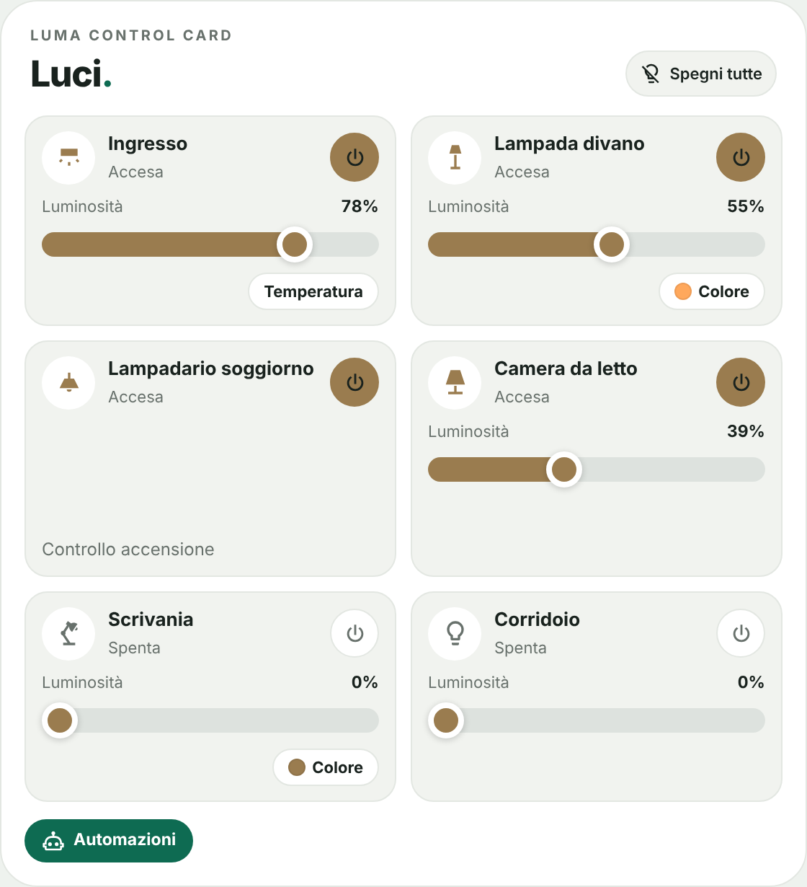
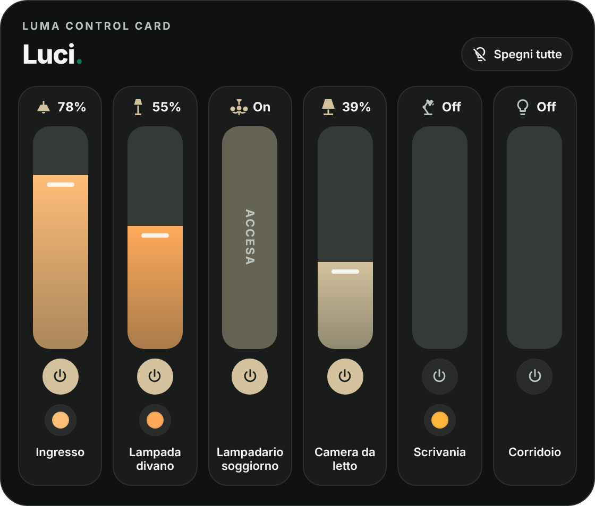
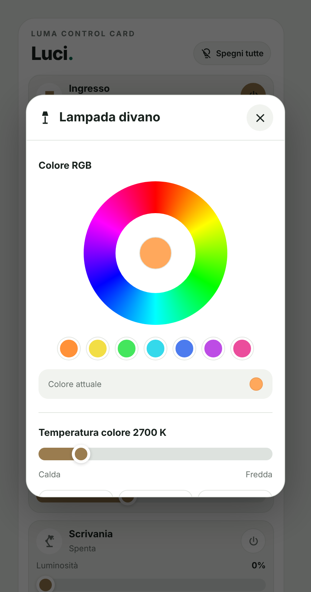

# Luma Control Card

## Overview

**Luma Control Card** is a custom lighting control card for Home Assistant dashboards, designed with a minimalist interface inspired by the Edera Light and Graphite Dark visual styles.

It shows multiple lights as vertical brightness faders in a compact, responsive layout. Color, color temperature, timer, and automations for each light are available in its details popup.

The card uses existing Home Assistant entities and services. No dedicated account, paid API, additional cloud service, or Edera theme installation is required.

## Preview

| Light | Dark |
| --- | --- |
|  |  |

*Previews use fictional demo data. Available controls depend on the configured lighting entities and their supported capabilities. The interface text is currently in Italian.*

## Features

- Vertical brightness faders, one per `light.*` entity, with a dedicated on/off button.
- Tapping a fader never changes the level: brightness changes only by dragging, and a light is never turned on by accident.
- Navigation arrows when the lights do not fit the available width.
- Details popup for each light with status, RGB color wheel and presets, color temperature, optional timer, and its automations.
- Per-light automations with individual enable/disable controls.
- Optional card-level automation buttons below the lights.
- Optional ambient glow, and options to hide the header eyebrow and the title.
- Turn off all configured lights with one command.
- Automatic, Edera Light, and Graphite Dark appearance modes.
- Visual configuration editor with entity selection, reordering, customization, and removal.
- Responsive popups optimized for desktop, tablet, and smartphone.
- No telemetry, external JavaScript libraries, or paid API dependencies.

Controls are displayed according to the capabilities reported by each light.

## Installation

### HACS (Recommended)

Install Luma Control Card directly from the default HACS catalog.

1. Open **HACS** in Home Assistant.
2. Search for **Luma Control Card**.
3. Select **Luma Control Card** from the results.
4. Click **Download** to install the card.
5. Reload your dashboard if necessary.
6. Add **Luma Control Card** to your dashboard and configure it using the visual editor.

To install a specific release, use **Download** or **Redownload** and select the desired version when available.

### Alternative: Custom repository

If you prefer to add the repository manually:

1. Open **HACS** and select **Custom repositories** from the menu.
2. Enter `https://github.com/luigi-regolo/luma-control-card`.
3. Select **Dashboard** as the repository type and add it.
4. Find **Luma Control Card** in HACS and download it.

### Manual installation

1. Download `dist/luma-control-card.js`.
2. Copy the file into the `www` directory of your Home Assistant configuration.
3. Open **Settings → Dashboards → Resources**.
4. Add `/local/luma-control-card.js` as a **JavaScript module**.
5. Reload the dashboard and add **Luma Control Card**.

## Configuration and Usage

### Visual Editor

The visual editor includes four sections:

- **Devices:** Select `light.*` entities, customize names and optional MDI icons, reorder devices, assign automations to each light, or remove them.
- **Appearance:** Configure the title, header, theme, and ambient glow.
- **Automations:** Optionally associate existing `automation.*` entities as buttons on the card.
- **Advanced:** Enable or disable the card's controls.

### Lighting Controls

Each light is shown as a vertical fader. Drag it to set the brightness, or use the arrow keys when it is focused. Tapping the fader does not change the level. Use the power button below it to turn the light on or off.

**Details and status** opens the details popup, where color, color temperature, timer, and the light's automations are available when supported by the light and the configuration.

The **Turn off all** button switches off the configured lights without disabling their associated automations.

### Automations

Existing Home Assistant automations can be enabled or disabled from the details popup of each light, or from optional buttons on the card.

The card does not create automations or immediately execute their actions when enabled.

### Timed Lighting

An optional `timer.*` helper can be associated with an individual light.

The card can start or cancel the timer. To switch off a light when the timer expires, a separate Home Assistant automation must handle the `timer.finished` event.

The card does not independently execute scheduled actions in the background.

## Compatibility and Requirements

- Home Assistant with support for custom JavaScript dashboard cards.
- Compatible `light.*` entities.
- Optional `automation.*` entities for automation management.
- Optional `timer.*` helpers for timed controls.
- No additional frontend libraries required.

Device capabilities and available controls depend on the configured Home Assistant integrations.

All actions use Home Assistant services and are subject to the user's Home Assistant permissions.

## Privacy and Security

Luma Control Card does not independently collect telemetry, store credentials, or communicate with external services.

The card runs within the Home Assistant dashboard and uses the entity data and services available to the current user.

## Releases

See [GitHub Releases](https://github.com/luigi-regolo/luma-control-card/releases) for published versions.

## Copyright & License

Copyright © 2026 luigi-regolo.

Original project created and maintained by **luigi-regolo**.

Licensed under the **GNU General Public License version 3 only (GPL-3.0-only)**.

See [LICENSE](LICENSE) for the complete license terms.

The software is provided without warranty to the extent permitted by applicable law.
