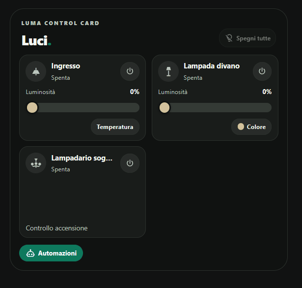

# Luma Control Card

## Overview

**Luma Control Card** is a custom lighting control card for Home Assistant dashboards, designed with a minimalist interface inspired by the Edera Light and Graphite Dark visual styles.

It brings together multiple lights in a compact, responsive layout with brightness adjustments, RGB color selection, color temperature controls, and optional automation and timer management.

The card uses existing Home Assistant entities and services. No dedicated account, paid API, additional cloud service, or Edera theme installation is required.

## Preview

*Luma Control Card interface in Graphite Dark mode. Available controls depend on the configured lighting entities and their supported capabilities.*

## Features

- Compact, responsive lighting grid with configurable layout.
- Individual on/off controls for `light.*` entities.
- Brightness adjustment for compatible lights.
- RGB color wheel with quick color presets.
- Adjustable color temperature with warm, neutral, and cool presets.
- Turn off all configured lights with one command.
- Multiple Home Assistant automations with individual enable/disable controls.
- Optional timer controls for individual lights.
- Automatic, Edera Light, and Graphite Dark appearance modes.
- Visual configuration editor with entity selection, reordering, customization, and removal.
- Responsive popups optimized for desktop, tablet, and smartphone.
- No telemetry, external JavaScript libraries, or paid API dependencies.

Controls are displayed according to the capabilities reported by each light.

## Installation

### HACS

1. Open **HACS** in Home Assistant.
2. Open the menu and select **Custom repositories**.
3. Enter `https://github.com/luigi-regolo/luma-control-card`.
4. Select **Dashboard** as the category.
5. Add the repository and download **Luma Control Card**.
6. Reload the dashboard and add the card using the visual editor.

### Manual installation

1. Download `dist/luma-control-card.js`.
2. Copy the file into the `www` directory of your Home Assistant configuration.
3. Open **Settings → Dashboards → Resources**.
4. Add `/local/luma-control-card.js` as a **JavaScript module**.
5. Reload the dashboard and add **Luma Control Card**.

## Configuration and Usage

### Visual Editor

The visual editor includes four sections:

- **Devices:** Select `light.*` entities, customize names and optional MDI icons, reorder devices, or remove them.
- **Appearance:** Configure the title, header, theme, and grid layout.
- **Automations:** Associate multiple existing `automation.*` entities and manage their enabled state.
- **Advanced:** Enable or disable the card's controls.

### Lighting Controls

Each configured light displays the controls supported by its Home Assistant integration.

Brightness, RGB color, and color temperature controls are displayed only when available.

The **Turn off all** button switches off the configured lights without disabling their associated automations.

### Automations

Existing Home Assistant automations can be enabled or disabled directly from the card.

The card does not create automations or immediately execute their actions when enabled.

### Timed Lighting

An optional `timer.*` helper can be associated with an individual light.

The card can start or cancel the timer. To switch off a light when the timer expires, a separate Home Assistant automation must handle the `timer.finished` event.

The card does not independently execute scheduled actions in the background.

## Compatibility and Requirements

- Home Assistant with support for custom JavaScript dashboard cards.
- Compatible `light.*` entities.
- Optional `automation.*` entities for automation management.
- Optional `timer.*` helpers for timed controls.
- No additional frontend libraries required.

Device capabilities and available controls depend on the configured Home Assistant integrations.

All actions use Home Assistant services and are subject to the user's Home Assistant permissions.

## Privacy and Security

Luma Control Card does not independently collect telemetry, store credentials, or communicate with external services.

The card runs within the Home Assistant dashboard and uses the entity data and services available to the current user.

## Copyright & License

Copyright © 2026 luigi-regolo.

Original project created and maintained by **luigi-regolo**.

Licensed under the **GNU General Public License version 3 only (GPL-3.0-only)**.

See [LICENSE](LICENSE) for the complete license terms.

The software is provided without warranty to the extent permitted by applicable law.
